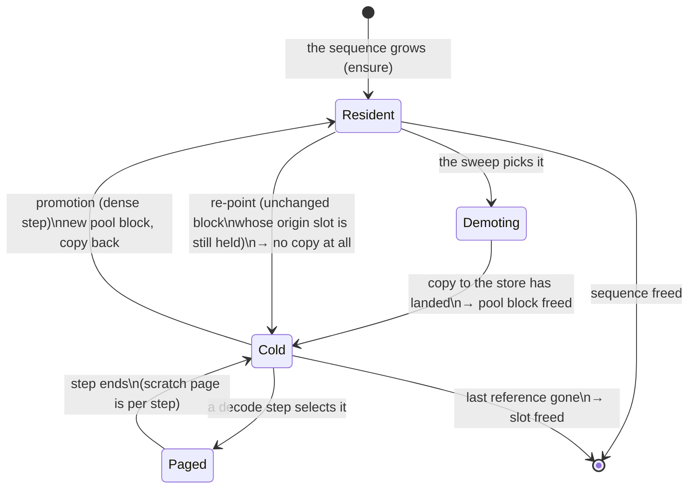
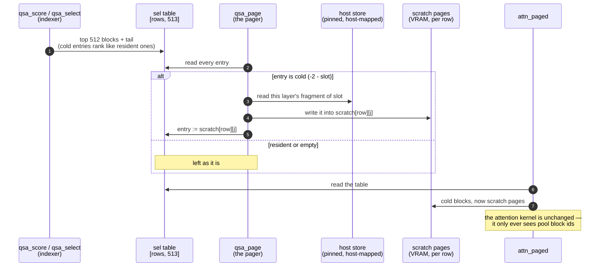
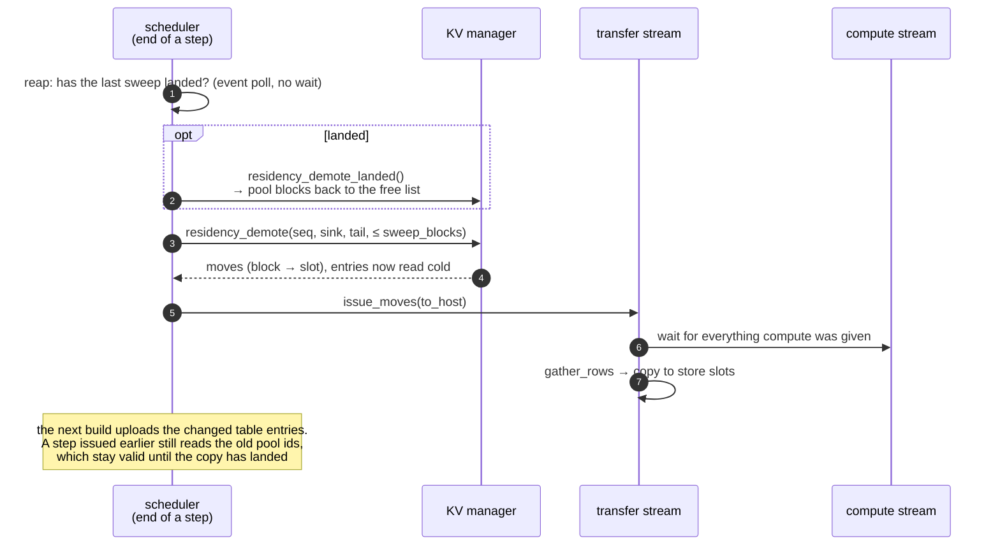
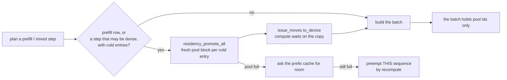
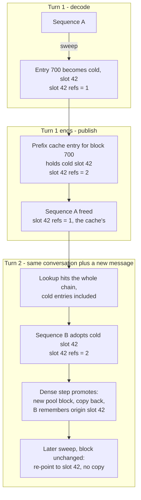
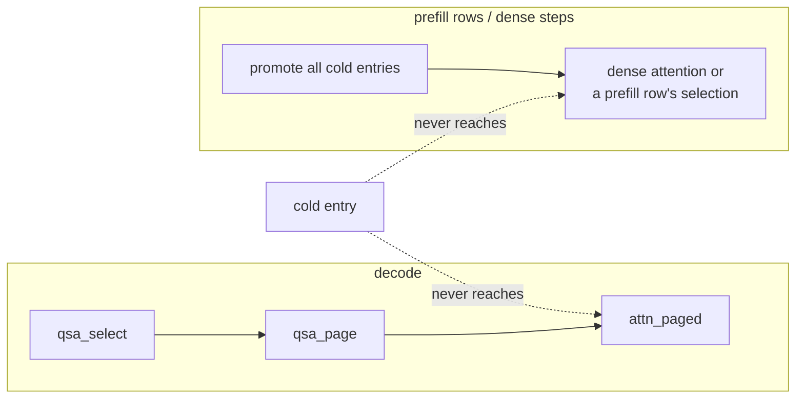

# [WIP]RadianceMemory — window residency for sparse-attention KV

RadianceMemory keeps a long conversation's KV cache on the card **only where the model actually reads
it**. Everything else sits in pinned host memory and comes back for the steps that need it. Those
steps produce the same bytes they would have produced with everything resident.

It is built for models whose attention reads a *selected* part of the history. For Qwen3.8-Flash-Next
(QSA) at 200 K tokens of context, the attention cache is 4.80 GiB a sequence, and a decode step reads
about 48 MiB of it. The rest is VRAM nothing touches.

This document covers only the KV memory system. The engine it runs in is radiance, documented in
[`docs/RADIANCE.md`](docs/RADIANCE.md) and the rest of `docs/`.

---

## Contents

1. [The idea in one picture](#1-the-idea-in-one-picture)
2. [What a block can be](#2-what-a-block-can-be)
3. [Which blocks stay on the card](#3-which-blocks-stay-on-the-card)
4. [A decode step: the pager](#4-a-decode-step-the-pager)
5. [The sweep: how blocks leave the card](#5-the-sweep-how-blocks-leave-the-card)
6. [Dense steps: promotion](#6-dense-steps-promotion)
7. [The prefix cache: cold blocks stay reusable](#7-the-prefix-cache-cold-blocks-stay-reusable)
8. [Memory accounting](#8-memory-accounting)
9. [Correctness: why the output does not change](#9-correctness-why-the-output-does-not-change)
10. [Using it](#10-using-it)
11. [What it measures](#11-what-it-measures)
12. [How it relates to `--kv-resident` (KV streaming)](#12-how-it-relates-to---kv-resident-kv-streaming)
13. [Limits and open points](#13-limits-and-open-points)
14. [Where the code is](#14-where-the-code-is)

---

## 1. The idea in one picture

A QSA layer does not attend to the whole history. A small **indexer** scores every 4-token block of
keys and keeps the best 512 blocks. The attention then reads those blocks plus the incomplete tail.
Which 512 blocks are kept changes from step to step, but two regions are read on nearly every step:
the very start of the conversation (the attention sinks) and its end (the recent tail).

```
 one sequence, 12 542 tokens = 3 136 blocks of 4 tokens
 ┌────────────┬──────────────────────────────────────────────────────┬──────────────────┐
 │ sink       │                     the middle                       │ tail             │
 │ 512 tokens │                                                      │ 2 048 tokens     │
 │ VRAM       │        host store, brought back only when selected   │ VRAM             │
 └────────────┴──────────────────────────────────────────────────────┴──────────────────┘
      ▲                     ▲          ▲        ▲                             ▲
      │                     │          │        │                             │
      └──── read every step ┘   a few blocks the indexer picks this step       └ read every step
```

Without RadianceMemory, the whole bar is in VRAM. With it, the middle leaves the card, and the
handful of middle blocks a step's selection names are paged back in for that step only.

---

## 2. What a block can be

The block table each sequence holds is the attention's map from a position in the history to the
bytes of that position's keys and values. An entry has one of three meanings:

| entry | meaning | where the bytes are |
|---|---|---|
| `>= 0` | a pool block id | in the VRAM KV pool |
| `-1` | empty | nowhere — no block at this position |
| `-2 - slot` | **cold** | in slot `slot` of the pinned host residency store |

The encoding is part of the plugin ABI (`rad_kv_cold_entry`, `rad_kv_entry_cold`,
`rad_kv_entry_slot` in `abi/rad_runtime.h`). A cold entry keeps its place in the table, so the
sequence's context is the same table of the same positions. Only where one entry's bytes live has
changed.

A block's life:



* **Demoting.** The copy to the host store is in flight. The entry already reads cold, but the pool
  block keeps its reference until the copy has landed, so nothing can reuse it while it is being
  read.
* **Paged.** A decode step selected the cold block. The pager copied it into one of that step's
  scratch pages, and the step's selection points there. On the next step that copy is gone and the
  entry is cold again. Nothing in the table changed.

---

## 3. Which blocks stay on the card

The model plugin declares how much of the history its consumer reads. In `arch/common/rad_qsa.h` the
attention group `kv_attn` declares the indexer's budget, 2 048 tokens, through
`rad_kv_set_residency_window`. The block-key group `kv_qsa_bkey` declares **nothing**: the indexer
scores every block key on every step, so those pages must stay resident. At bf16 they are 3.25 of the
29.25 KiB a 4-token block costs, and no window can shrink them. `--qsa-bkey-dtype i8` stores them as
int8 with one f16 scale a key, 1.73 KiB a block (the page 136 bytes a layer), so the resident floor
under residency drops from 832 to 442 bytes a token a card ([`docs/QSA.md`](docs/QSA.md),
"Block-key storage").

Only a group that declares a window is ever demoted. For that group a sequence keeps two ends:

```
 table entry index   0 ............ H-1 | H ........................ N-T-1 | N-T ......... N-1
                     └─ sink: kept ─────┘└──── demotable ──────────────────┘└─ tail: kept ───┘
   H = ceil(--kv-residency-sink-tokens / block)      T = ceil(declared window / block)
   the last entry (the partial block an append writes into) is never demoted
```

**Why two ends and not one window.** The selection is not positional: the top 512 come from
anywhere. If only a tail window stayed resident, the sinks would be demoted and then promoted on
every step, which costs more than it saves.

**What a sweep never demotes:**

* the sink and the tail,
* the last, partial block, because the next token is written into it,
* a block another live sequence also holds, such as a forked child or a second request that hit
  the same cached prefix: that sequence's step reads it through its own table. The prefix cache
  follows a demotion instead, as described in [§7](#7-the-prefix-cache-cold-blocks-stay-reusable).

---

## 4. A decode step: the pager

The host never learns which blocks a decode step reads. `qsa_select` decides that on the card,
inside the step. The fetch therefore also happens on the card: a kernel, `qsa_page`, runs between
the selection and the attention of every QSA layer.



Properties of the pager:

* **No host synchronisation.** The store is allocated host-mapped, and the card reads it over PCIe
  directly.
* **Deterministic.** Every position `(row, j)` has exactly one writer and there are no atomics. The
  result is byte-identical to the reference in `libref`, which `r4d_selftest` checks.
* **Per layer.** The plugin folds the layer's offset into the store pointer on the host, so the
  kernel never reads host-side tables.
* **Counted.** The kernel adds the number of entries it rewrote to one int64 on the card (`paged_in`).
  `/stats` reads that counter back on a poll, never per step.
* **Scratch.** Each decode row has `topk + 1` scratch pages of its own. They are reserved when the
  pool is carved and are valid for one step.

`qsa_select` changed in one place: a block is absent exactly when its entry is `-1`. It used to be
"any negative". This is what lets a cold block be selected at all. Its *score* is unaffected, because
`qsa_score` reads `kv_qsa_bkey`, which is never demoted.

---

## 5. The sweep: how blocks leave the card

After every committed step, decode, mixed or prefill, the scheduler sweeps. It demotes at most a
bounded number of blocks per step, across all sequences, and only one sweep is in flight at a time.

**Which sequences.** Every running one that is done prefilling. A sequence still mid-prompt is
skipped (its next chunk would promote it whole again, [§6](#6-dense-steps-promotion)), and so is one
whose last chunk was this step: the drafter's history pass over that chunk follows the commit and
pages only the rows the scratch holds. It is swept from the next step on. Sweeping after decode
steps only, as before, left every decoding conversation's middle in VRAM for as long as prompts
kept arriving, since nearly every such step is mixed.

**How much.** `TierExec::sweep_blocks`: a byte budget of 32 MiB a rank (`TierExec::kSweepBytes`),
in blocks of the widest residency group's store block, at least 64 and at most the 1 024 entries of
the transfer's index ring. 32 MiB is about 1.5 ms of a PCIe 4.0 x16 link, each rank on its own; the
copy runs after the step already queued and only the step after it waits for it, so a copy well
under one decode step is hidden. On Flash-Next at `--tp 2` (26 KiB a rank's fp8 block) that is the
ring's 1 024 blocks, 4 096 tokens a sweep: a 128K-token middle (~31K blocks) drains in ~31 sweeps,
about 60 steps, instead of ~490 sweeps at the old fixed 64. The host pays ~30 async calls a batch of
16 (index upload, a gather a layer, a copy a block), ~2 K a sweep and rank. The index ring starts
over once every earlier move has landed, so a sweep never waits on the host for its wrap
(`MoveStats::idx_syncs`); a promotion of a whole middle still can.



The rules that keep this safe without any host wait:

1. **A block is freed only after its copy has landed.** The copy waited on the compute stream, so
   every step that could read the block in place has already been queued ahead of it.
2. **A freed block's new owner writes it only in a later step** on the same in-order compute stream,
   after every earlier reader.
3. **A promotion waits on the compute stream before it writes**, because it writes into a block the
   pool just handed out, which a step issued ahead may still be reading under its previous owner.
4. **One sweep in flight.** Landing is a poll of the newest transfer, so a sweep issued every step
   would keep the newest transfer always pending and never free anything.

**The sweep resumes where it left off.** Each sequence remembers, per group, the first table entry
not yet decided (cold, or kept because the prefix cache or a fork shares it). A step's sweep
starts there, so it costs the entries that are new since the last one, not the whole context. The
mark goes back when the table changes (append, promotion, rollback, adoption, preemption), when a
shared block loses its last other holder, and it stops at an entry a full store kept. The blocks it
moves are the ones a walk of the whole table would move (`mem_test`).

---

## 6. Dense steps: promotion

A step that reads a table densely would read a cold entry's store slot as a pool block id. Which rows
do that is decided per step by the attention (`rad_block_attn_gated_fp8.h`): the whole step is dense
only while `max_ctx_len + max_q_len <= qsa_exact_to = budget + ratio - 1` (2 051 tokens on
Flash-Next); past it every row, decode and prefill, reads its own selection (`sel`). So before a
prefill or mixed step the scheduler promotes (`Scheduler::res_dense_rows`):

* every **prefill row** with cold entries. A sparse prefill row reads only its selection, but the
  pager cannot serve it: the scratch is `topk + 1` pages a decode row for `max_seqs × (1 + n_spec)`
  rows, and a chunk is up to thousands of query rows each selecting 512 blocks (see
  [§12](#12-how-it-relates-to---kv-resident-kv-streaming) for what serving it from the store would take);
* the **decode rows** only when the step may be dense, i.e. no entry's `ctx_len + n_tokens` passes
  `window + block - 1` (the plugin's `qsa_exact_to`, pinned by `arch_test`). In a sparse mixed step
  they keep their cold entries and page what they select, exactly as in a decode step: a long
  conversation that merely shares a step with a prompt no longer comes back to VRAM whole.



Promotion is all or nothing per sequence. If the pool cannot hold a sequence's cold blocks even after
the prefix cache has given up room, **that** sequence is preempted and re-prefilled. Preempting the
back of the running set instead would usually hit the prompt that made the step mixed. That prompt
would be readmitted at once into the same failing step while the cold sequence never decodes, which
is a livelock that a test now covers.

---

## 7. The prefix cache: cold blocks stay reusable

A conversation that comes back for its next turn should hit the prefix cache, cold middle included.
To make that possible, store slots are **reference counted**. A cold entry can sit in several
sequence tables and in prefix-cache entries at the same time, and the slot is freed when its last
holder lets go.



* **A hit is a copy, not a recompute.** On Flash-Next a warm 8 887-token prefill went from 1 601 ms
  back to 92.7 ms. With residency off it is 70.1 ms.
* **Re-point instead of re-copy.** A block promoted from slot S and not written since (prefix blocks
  are immutable, only the partial tail is written) is demoted by pointing its entry back at S. No
  bytes move, and the store does not gain a copy of the same prefix every turn.
* **The idle tiers** (the host tier for finished conversations, `--prefix-cache-mib`) are never handed
  an entry with a cold component. They gather pool blocks, and that part's bytes are already in host
  memory. An entry that goes cold after its copy was taken gives the copy up (`IdleTiers::forget_copy`);
  its session row stays, since its chain still hits.
* **A block the cache shares with one sequence moves.** The sweep used to skip every block the cache
  held, so a follow-up's adopted resident entries (the last turn's sink and tail) stayed on the card
  for the whole turn and piled up turn after turn. The only other reader of such a block is a later
  hit, which adopts whatever the entry names and promotes a block of its own, so the block is
  demoted like the sequence's own and the cache entry is re-pointed at the same slot with a
  reference of its own (`KVManager::set_residency_cache`, `PrefixCache::repoint_cold`). A block a
  second live sequence also holds still stays.
* **An idle conversation leaves the card.** Published and freed, a conversation waiting for its next
  turn is held by the cache alone. After the sequences, the sweep spends what is left of its budget on
  those blocks (`KVManager::residency_demote_cached`, oldest first, re-pointing a block promoted from
  a slot and unchanged since). All of the chain goes, sink and tail included: the next turn's prefill
  row promotes the whole chain anyway (§6), so keeping them would save one ~640-block copy a turn and
  cost that much VRAM for every idle conversation. Before, in 32 × 128K runs, `skipped` ran into the
  millions, idle conversations filled the pool, the cache was evicted and follow-ups recomputed.

---

## 8. Memory accounting

```
                       VRAM (per rank)                              pinned host
  ┌──────────────────────────────────────────────────────┐   ┌───────────────────────────┐
  │ KV pool                                              │   │ residency store           │
  │ ┌──────────┬──────────────────────┬────────────────┐ │   │ --kv-residency-mib        │
  │ │ scratch  │ resident blocks      │ free blocks    │ │   │ one block a slot,         │
  │ │ pages    │ (sinks, tails, block │  ← demoted     │ │   │ every rank's shard        │
  │ │ held for │  keys, short seqs)   │    blocks      │ │   │ at its own offset         │
  │ │ the pager│                      │    land here   │ │   │                           │
  │ └──────────┴──────────────────────┴────────────────┘ │   └───────────────────────────┘
  └──────────────────────────────────────────────────────┘
```

| item | size | where it is charged |
|---|---|---|
| scratch pages | `(window/block + 1) × max_seqs × (1 + n_spec)` blocks per residency group, about 208 MiB on Flash-Next at 8 decode rows | fixed costs, before the VRAM split, so the budget resolver sees them |
| residency store | `--kv-residency-mib`, one store per residency group, its slot one block of that group (every rank's shard) at that group's own layout's size; the budget is split so every store holds the same tokens (in proportion to a group's bytes a token), so it holds (store bytes) / (the groups' real block bytes) blocks a group, not / the widest | pinned host memory, opened host-mapped |
| per-block bookkeeping | 4 bytes a block (the table entry already holds the slot) | none worth counting |

At 200 K tokens a sequence holds 50 K attention blocks. With a 512-token sink and a 2 048-token tail
resident, it needs about **51 MiB instead of 4.80 GiB** on the card, before the shared scratch. Its
block keys stay resident beside that: 159 MiB at bf16, 84 MiB with `--qsa-bkey-dtype i8`. The block-key
group's page is whatever its declaration says, so the pool, the prefix cache and the residency store
size it from there unchanged.

### Tiered precision: the demoted middle in a narrower layout

A recipe line may name a second layout for the blocks the sweep demotes (RAD_KVQ_DEMOTE,
`abi/rad_builder.h`):

```
vmean kv_vmean.txt
layer 3  i8h demote k4h_v2h vmean        # resident i8h, the store k4h_v2h
layer 15 fp8 rotated demote k4h_v4       # fp8 must be rotated: the demoted block keeps its basis
```

The sink and the tail, read on almost every step, stay in the resident layout; the middle sits in
the store in the demote layout and comes back expanded. Served: i8h or a rotated fp8 layer
resident, k4h_v4 or k4h_v2h demoted.

* **Where the requantise and the expand run.** On the card, as the op `kv_transcode`
  (docs/OPS.md): the demotion gathers the block's layers, transcodes every (token, head) row into
  the demote layout and copies those bytes to the slot; a promotion copies them back and expands
  them before the scatter; the pager (`qsa_page` with `store_layout` and `pool_layout`) expands a
  cold fragment straight into its scratch page. One codec serves all three, so attention reads one
  layout per layer and no attention kernel changed.
* **Basis and V mean.** The transcode decodes and encodes values in the stored units and does not
  rotate, centre or rescale. Both layouts therefore share the layer's rotation and V mean: a k4h
  demote layout needs a rotated layer, and `vmean` (accepted when either layout has integer V)
  centres the resident and the demoted bytes alike.
* **Store sizing.** A tiered layer's slot fragment is its rows at the demote width, so its
  group's slot is its *demote* block (startup prints `stored as k4h_v2h, N KiB a block`). On Flash-Next at
  `--tp 2` a rank's i8h block (12 layers + the head's, one KV head, 4 tokens) is 13 × 2 064 =
  26.2 KiB in VRAM and 13 × 896 = 11.4 KiB in the store as k4h_v2h, 13 × 1 152 = 14.6 KiB as k4h_v4.
* **Re-pointing.** A promoted tiered block keeps its origin slot even when no cache holds it, so an
  unchanged block re-demotes by pointing back (no bytes, no second rounding). A block is rounded
  through the demote layout once in its life; the cost is that a resident block can hold a slot.
* **Prefix cache.** Cold entries hold demote-precision bytes, and a returning conversation is
  promoted from them: its middle comes back at the demote precision, never better. The idle tiers
  still take only resident blocks.
* **The emulation** (`RADIANCE_DEBUG_KV_TIER=emulate`, with the same flags): the sweep picks exactly
  the blocks it would demote and the mover runs the demote → expand round trip on them in place;
  nothing moves. Residency-on output is compared with it byte for byte, both under
  `RADIANCE_DEBUG_KV_TIER=sync` semantics (each sweep is waited for, so which step first reads a
  demoted block does not depend on transfer timing). In the KL mode, which scores prefill chunks and
  runs no decode step, the emulation sweeps after every step, unbounded.

Measured on two R9700s (Flash-Next `--tp 2`, bf16-cache reference, residency on, KL through the
emulation; `prep/aq/m8/{kl,recall,mr}/fix-*.json`, all taken after the fix of the
sweep's shared index buffer, below).
Three corpora: `long.jsonl` (4 documents of ~34K tokens, every position past ~30K scored), `recall.jsonl`
(a ~2 000-token passage repeated ~26K tokens later, only the repeat scored) and `mr.jsonl` (four
conversations of four turns, each pasting ~6 000 tokens of a file and answered by the model itself at
bf16, then a fifth turn asking about the first file; only that last answer, 256 tokens, is scored):

| configuration | store a block (both ranks) | long KL / top-1 / ΔNLL | recall KL / top-1 | multi-round KL / top-1 / ΔNLL |
|---|--:|--:|--:|--:|
| uniform i8h | 52.5 KiB | 0.0236 / 94.77 % / −0.0024 | 0.0103 / 99.77 % | 0.0032 / 98.63 % / −0.0016 |
| i8h, demote k4h_v4 + vmean | 29.25 KiB | 0.0284 / 93.91 % / +0.0012 | 0.0151 / 99.62 % | 0.0047 / 98.43 % / −0.0003 |
| i8h, demote k4h_v2h + vmean | 22.75 KiB | 0.0408 / 93.00 % / +0.0028 | 0.0183 / 99.62 % | 0.0063 / 97.55 % / **+0.0043** |
| uniform k4h_v2h + vmean | 22.75 KiB | 0.0833 / 89.90 % / **+0.0132** | 0.0214 / 99.61 % | 0.0177 / 96.27 % / **+0.0190** |

For scale, the bf16 model itself computed in another prefill order measures 0.0243 (long) and 0.0033
(multi-round). A `k4h_v4` middle stays within that noise everywhere; a `k4h_v2h` middle costs less than
half of what `k4h_v2h` everywhere costs, but on the multi-round corpus its NLL change is significant
(+0.0043, 95 % from +0.0004 to +0.0111; uniform: +0.0190). ΔNLL intervals are block bootstraps.

A paged block moves its demote-layout fragment over PCIe: 896 B a layer and rank as k4h_v2h,
1 152 B as k4h_v4, 2 064 B as i8h. Residency on against the emulation, 12 452 prompt tokens and 256
greedy tokens, is byte-identical for both demote layouts (`prep/aq/m8/identity-tier.sh`).

**The shared index buffer.** Before this, every batch of a sweep gathered its blocks through one
pinned index buffer that the transfer stream read only when it got past compute, so a batch could
gather the last batch's blocks: residency output was then timing-dependent, tiered or not. Each batch
now owns an entry of a ring of 64, with a stream sync when it wraps; two KL runs of a tiered recipe
are byte-identical. **Open:** with a tiered recipe, int8 block keys (`--qsa-bkey-dtype i8`) and the MTP
drafter together, residency on and the emulation diverge (identical with `--num-speculative-tokens
0`); the drafter's acceptance falls from about 0.68 to 0.10 once blocks really move, also untiered.

---

## 9. Correctness: why the output does not change

The only things that differ between a resident run and a paged one are where bytes live and which
page id the attention reads them through. The kernels never see a cold id:



The checks:

| check | what it shows | where |
|---|---|---|
| **identity on the card** | Flash-Next `--tp 2`, a 12 542-token prompt, 256 greedy tokens: paged output **byte-identical** to the fully resident run, with `paged_in > 0` **and** `freed_bytes > 0` (a run that pages nothing, or frees nothing, fails) | `prep/60-flashnext-identity.sh` |
| pager vs reference | `qsa_page` on the card equals libref byte for byte: aligned and odd fragments, a skewed store, the pool in its real KV shape | `r4d_selftest --case qsa_page_u8` |
| selection with cold entries | a cold entry is chosen exactly where a resident one with the same score would be, in both ranking modes | `r4d_selftest --case qsa_select_i32` |
| a block comes back intact | demoted, the pool overwritten, promoted: byte for byte, and only the named blocks moved | `mem_test` (host backend) |
| no leaks | slots and blocks across demote, promote, preempt, rollback, fork, eviction, trim, expiry, re-plan | `mem_test` |
| scheduler | sweep bound, sink and tail never demoted, dense steps and prefill rows see pool ids only, a sparse mixed step's decode rows stay cold for the pager, no livelock on a full pool | `sched_test` |
| where a mixed step is sparse | one token past `window + block - 1` every attention launch reads `sel`; at it the step is dense | `arch_test` |
| drafts page too | the MTP head's draft passes stage their rows as decode rows, so its `qsa_page` runs and it never reads a cold block as absent | `sched_test` |
| why drafts must match too | under `--state-cache-dtype f16` the anchor state is rounded once a step, so the text depends on how many drafts each step accepts (f32 does not): residency that changes a draft changes the text there | `ref_test` |

---

## 10. Using it

```sh
radiance --model flashnext.rad --tp 2 \
         --kv-residency-mib 4096 \           # the host store; 0 (default) = off
         --kv-residency-sink-tokens 512      # start of a conversation kept resident
```

* A model must declare a window for anything to happen. Today that is the QSA family
  (`arch/qwen4exp_fp8`). On other models the flag does nothing, and startup says so.
* The flag is exclusive with `--kv-resident` (KV streaming, [§12](#12-how-it-relates-to---kv-resident-kv-streaming)).
  The server refuses both together.
* Startup prints the store, its slot count, the scratch reservation and the window, for example
  `kv residency: window enforced -- after a step, blocks outside the sink and the 2048-token tail
  leave the pool for the store, 16 per batch and at most 32.0 MiB a rank per step`, then
  `kv residency: a sweep moves at most 1024 blocks of 26.0 KiB a rank (26.0 MiB), after any step, of
  sequences not prefilling`.

**Counters**, in `/stats` under `kv_residency` and per session in `/sessions`:

| field | meaning |
|---|---|
| `demoted`, `promoted` | blocks moved to the store / back to the pool |
| `freed_bytes` | VRAM the landed demotions gave back to the pool |
| `paged_in` | cold entries the pager rewrote on the card (summed over QSA layers and decode rows; rank 0) |
| `skipped` | blocks a sweep left (held by another live sequence, partial, store full) |
| `link_bytes` | bytes moved over PCIe, both directions |
| `host_bytes`, `cap_bytes` | store in use / store size |
| `scratch_bytes` | VRAM the pager's scratch pages hold |

---

## 11. What it measures

On two Radeon AI PRO R9700 (gfx1201), Flash-Next `qwen3.8-next-flash-fp8-iq4r-moe` at `--tp 2`,
BetterBench with a warm cache (`unique_nonce: false`), 2 passes, everything else equal:

| | residency off | residency on |
|---|--:|--:|
| warm prefill TTFT, 3 013 tokens | 39.2 ms | 42.4 ms |
| warm prefill TTFT, 8 887 tokens | 70.1 ms | 92.7 ms |
| decode, chat / code / summarization (t/s) | 166.4 / 196.8 / 134.3 | 163.9 / 192.4 / 135.3 |
| VRAM given back (per rank) | — | 200 MiB |

Decode is unchanged within the noise, though two passes are few. The warm prefill pays for the copy
back of the conversation's cold middle. Before the prefix cache learned to index cold blocks
([§7](#7-the-prefix-cache-cold-blocks-stay-reusable)), the same two numbers were 596 ms and 1 601 ms.

These are short contexts. The saving grows with context length, because the sink and tail stay
fixed while the middle grows, and the measurement that matters for the feature's purpose
(sessions per card at 100 K+ tokens) is still to be run.

---

## 12. How it relates to `--kv-resident` (KV streaming)

radiance 1.15 ships its own answer to the same problem, KV streaming ([`docs/KV-STREAMING.md`](docs/KV-STREAMING.md)).
The two are alternatives, and a server runs one of them.

| | window residency (`--kv-residency-mib`) | KV streaming (`--kv-resident N`) |
|---|---|---|
| authoritative copy | **VRAM**; the unread middle is demoted | **host**; a VRAM ring caches what is read |
| what stays on the card | positional: sink + tail of the declared window | adaptive: a ring of N blocks, CLOCK eviction by what the selection reads |
| fetch on the card | `qsa_page` → per-step scratch pages | `kv_resolve` → ring slots with a residency map |
| smallest useful context | ~2.6 K tokens (sink + tail) | the ring floor of 32 768 tokens; below it nothing streams |
| prefix cache | cold blocks indexed and reusable (§7) | exclusive with the prefix cache's host tier |
| a long conversation is | mostly on the card, its middle in host memory | mostly in host memory |

Choose window residency for contexts below the streaming floor, for workloads that reuse long
prefixes turn after turn, and for a card that has the VRAM for the tails. Choose streaming for very
long contexts on a card that cannot hold them at all.

### Prefill rows from the store instead of a promotion (design note, not built)

A returning conversation's prefill is sparse past 2 051 tokens, so each of its rows reads only its
selection, yet its whole cold middle is promoted first (§6), because the pager serves decode rows
only. Could a streaming-like resolve copy just what the chunk selects?

**What streaming does for prefill today.** Nothing selection-aware. `kv_pass_view`
(`core/kvstream/bind.cpp:32`) gives every non-decode pass, and every decode-classified pass wider
than `n_seq × (1 + n_spec)`, the **stage**: per layer, every block the step's tables name is copied
from the host mirror into a one-layer buffer at block-id identity (`kvstream_step_runs`,
`core/kvstream/stage.cpp:154`; ordering in `core/kvstream/stage.h`), decode rows of a mixed step
included, and `resolve_sel` returns early on a staged pass (`rad_block_attn_gated_fp8.h:993`). It
was built that way because one prefill launch's selection union is 70-100 % of the history
(KV-STREAMING.md §3.5: 23 429 of ~33 000 blocks at 133K tokens), which no ring holds.

**Can the residency store be the host source?** As bytes, yes: it is host-mapped and the card reads
it directly (`qsa_page` does, per layer, at `residency_layer_off`, expanding a tiered demote layout).
As a drop-in for the mirror, no: the mirror is one row a layer addressed by block id in the pool's
layout, the store is one slot a block (every layer and rank inside, possibly in the demote layout)
addressed by slot, and a cold entry has no block id to stage at. `kv_resolve` and the stage copy
cannot read it unchanged; `qsa_page`'s fragment copy and codec can.

**Copy volume, Flash-Next `--tp 2` fp8, a 128K-token conversation (~31.4K middle blocks, 26 KiB a
rank's block = 13 layers × 2 KiB).**

| | link a rank | VRAM held a rank during the prefill |
|---|--:|--:|
| promotion (today) | ~800 MiB once a turn; re-demoted by re-pointing at its origin slots, no copy | the middle, ~800 MiB |
| selection union per chunk | ~0.7 × 800 ≈ 560 MiB **a chunk** (each layer its own union) | the union, a pool page a block and layer: no saving |
| residency stage (streaming's shape) | ~800 MiB **a chunk** (cold H2D + resident D2D) | one layer of the history, ~64 MiB |

The union is no cheaper than the promotion for a one-chunk follow-up, and k chunks cost k times
as much. Its pages would have to be pool ids, which hold every layer, so it saves no VRAM either: the
only design that does is the one-layer stage. The gain of that design is **VRAM headroom, not link
bytes or TTFT**: a follow-up turn proceeds with ~64 MiB a rank free instead of ~800 MiB (a promotion
that does not fit preempts the sequence and recomputes 128K tokens, §6). The promotion's own cost
is ~37 ms of link a rank at ~22 GB/s.

**The work.** Not a contained change: (1) a per-rank stage buffer one layer deep, `max_ctx / block ×
fragment`, charged to the VRAM budget, and a per-step staged table for the prefill rows (stage index
per table entry); (2) a per-layer copy into it, cold fragments from store slots (with the tiered
expand) and resident ones from the pool, ordered like streaming's (copy L before L's store, L+1 after
every attention launch of L); (3) in `rad_qsa.h` the prefill rows' `qsa_select` on the staged table,
and in `rad_block_attn_gated_fp8.h` the sparse launches split at `n_tok_decode` (decode rows on the
pool and the pager, prefill rows on the stage) plus the identity store of the chunk's own K/V into the
stage; (4) the same for the MTP head's history pass; (5) libref / avx / r4d rows, selftests, and the
emulation. **Plan:** first measure, with the two changes above (sparse mixed steps no longer promote
decode rows, and the sweep drains a middle in ~60 steps), how often a follow-up's promotion fails
(`preemptions`, follow-up TTFT); build the stage only if it does.

---

## 13. Limits and open points

* **Only the QSA family declares a window.** GLM-5.3's sparse block does not yet.
* **`paged_in`** is rank 0's count, per layer (one block paged across 12 layers counts 12), and not
  per session, because the card cannot attribute a row to a session.
* **A promoted block keeps its origin slot** while it is resident, so the store can be fuller than
  the number of cold entries. A tiered block always does (§8, tiered precision).
* **The emulation equals residency only while the store has room**: a full store leaves blocks
  resident at full precision, which the emulation does not model. No per-block importance signal
  yet chooses between two demote layouts.
* **A demotion is now a dependency of the next step** (the step that reads the block through the
  pager waits for its copy to land): a stream wait, not a host sync, which closes a window where the
  pager could read a slot still being written.
* **Not yet tested with a host test:** the reap at the end of a step under step-ahead issue. The host
  fixtures do not issue ahead, so only the identity run on the card covers it.
* **The device kernel cannot refuse** the way the reference does. An entry whose slot or scratch id is
  out of range is left as it was, so a bad table never writes out of bounds. The reference's refusals
  are what keep such a table from being built.
* **Measurements so far are 2-pass and short-context.** Decode numbers need `--passes 20`, and the
  feature's real case is 100 K+ tokens.

---

## 14. Where the code is

| part | files |
|---|---|
| ABI: cold entries, batch fields, window declaration | `abi/rad_runtime.h`, `abi/rad_builder.h`, `abi/rad_abi.h` (ABI 33) |
| block states, slots, demote / promote / re-point | `core/mem/kv.{h,cpp}` |
| host-mapped store | `core/mem/hostarena.{h,cpp}` (`open_mapped`) |
| prefix cache with cold entries | `core/mem/prefix.{h,cpp}` |
| transfers | `core/runtime/tierexec.{h,cpp}` (`issue_moves`) |
| sweep, reap, dense-step promotion | `core/sched/scheduler.cpp` (`res_sweep`, `res_reap`) |
| engine wiring, store, mover, counter | `core/engine.cpp`, `core/engine_bringup.cpp` |
| the window declaration and the pager issue | `arch/common/rad_qsa.h` |
| the pager | `libref/ref_qsa.cpp` (reference), `libr4d/r4d_qsa_page_u8.hip` (card), `libavx/avx_qsa.cpp` |
| the demote layout's codec (`kv_transcode`, the expanding pager) | `libref/ref_attn.cpp` (`kvx_rows`), `libr4d/r4d_kvx.h`, `libavx/avx_qsa.cpp` |
| the selection change | `libr4d/r4d_qsa_select_bf16.hip` |
| spec and operator docs | `spec.md` §7.3 "Window residency", `docs/GUIDE.md` §4.8, `docs/OPS.md` `qsa_page`, `docs/qsa-residency-bench.md` |
