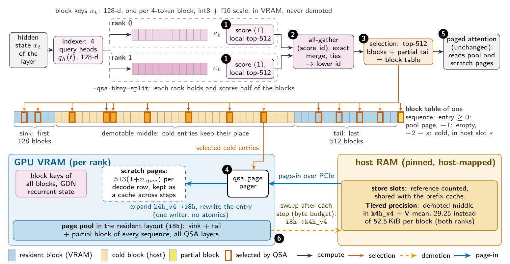
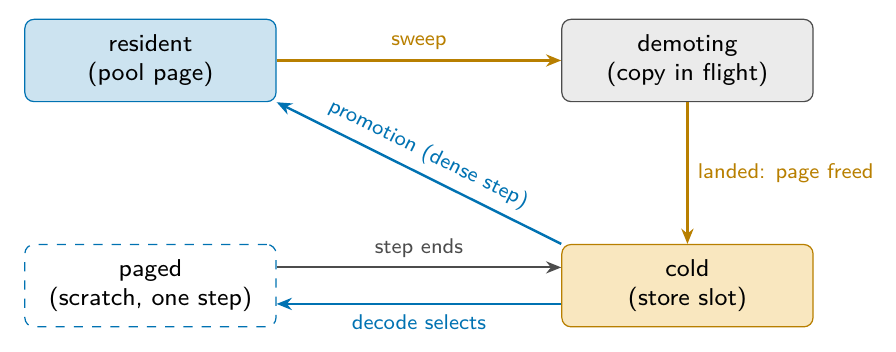
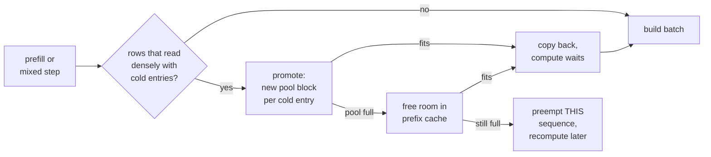
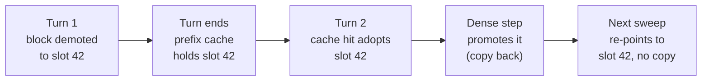
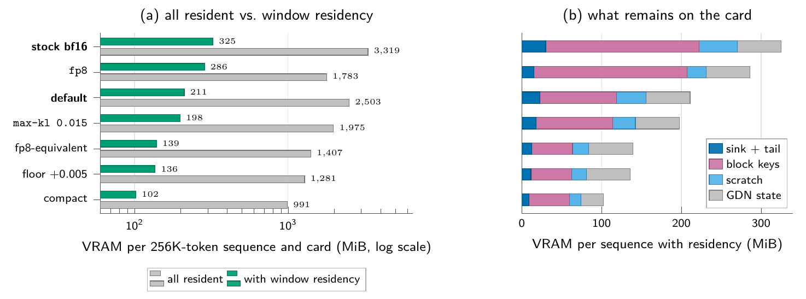
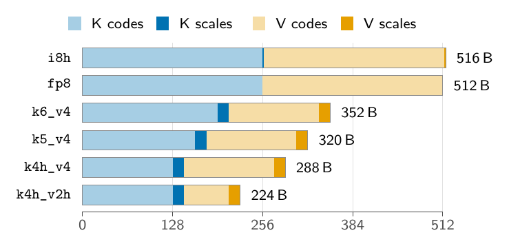
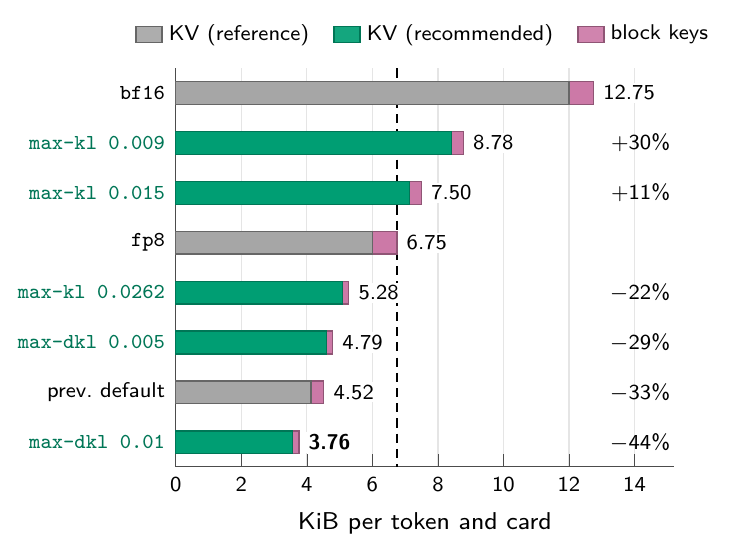

# RadianceMemory — window residency for sparse-attention KV

> **Status: work in progress.**

RadianceMemory keeps a long conversation's KV cache on the GPU **only where the model actually reads
it**. The rest sits in pinned host memory and is fetched for the steps that need it. The output is
**byte-identical** to a run with everything resident.

It is built for models whose attention reads a *selected* part of the history — today the QSA family
(Qwen3.8-Flash-Next). The engine it runs in is radiance, documented in
[`docs/RADIANCE.md`](docs/RADIANCE.md) and the rest of `docs/`.

**Paper:** [*Infinite KV Cache: Sparse-Attention-Aware Window Residency and Measured Per-Layer
Quantisation for a Hybrid MoE Model on AMD RDNA4*](docs/paper/Infinite_KV_Cache.pdf) (PDF, 23 pages).
All figures below are taken from it.

### At a glance

Qwen3.8-Flash-Next, tensor parallelism 2, two Radeon AI PRO R9700 (gfx1201):

| | without residency | with residency |
|---|--:|--:|
| VRAM for one 256K-token sequence, per card | 991 – 3 319 MiB | **102 – 325 MiB** (−90 … −97 %) |
| output | — | **byte-identical** |
| single-sequence decode | — | 3 – 15 % slower |
| 32 sessions × 128K tokens, follow-up time to first token (p50 / p95) | 1 843 / 3 330 s (fp8, cache evicted) | **58 / 96 s** (compact recipe) |

---

## Contents

1. [How it works in one picture](#1-how-it-works-in-one-picture)
2. [Blocks and their states](#2-blocks-and-their-states)
3. [Which blocks stay on the card](#3-which-blocks-stay-on-the-card)
4. [Decode steps: the pager](#4-decode-steps-the-pager)
5. [The sweep: how blocks leave the card](#5-the-sweep-how-blocks-leave-the-card)
6. [Dense steps: promotion](#6-dense-steps-promotion)
7. [Prefix cache: cold blocks stay reusable](#7-prefix-cache-cold-blocks-stay-reusable)
8. [Memory](#8-memory)
9. [Correctness](#9-correctness)
10. [Using it](#10-using-it)
11. [Measurements](#11-measurements)
12. [Window residency vs. KV streaming (`--kv-resident`)](#12-window-residency-vs-kv-streaming---kv-resident)
13. [Limits and open points](#13-limits-and-open-points)
14. [Where the code is](#14-where-the-code-is)

---

## 1. How it works in one picture



*One decode step of one QSA layer (paper, Fig. 1).*

1. **Score.** The indexer scores every 4-token block by its block key and keeps a top 512. With
   `--qsa-bkey-split` (shown), each rank holds and scores half the blocks.
2. **Merge.** An all-gather merges both lists exactly; ties go to the lower block id.
3. **Select.** The top 512 blocks plus the partial tail block form this step's block table.
4. **Page in.** The on-card pager `qsa_page` copies the selected **cold** blocks (orange in the bar)
   from pinned host memory into scratch pages and rewrites their table entries.
5. **Attend.** Paged attention runs **unchanged**: it only ever sees pool page ids.
6. **Sweep.** After the step, the middle of the history is demoted to host memory.

**Why it works:** QSA reads only 512 blocks per step, and the two regions it reads on almost every
step are predictable — the start of the conversation (**sink**, attention sinks) and its end
(**tail**). Those stay in VRAM; the middle moves to the host.

---

## 2. Blocks and their states

Each sequence has a block table that maps a history position to the bytes of its keys and values.
An entry has one of three meanings:

| entry | meaning | bytes live in |
|---|---|---|
| `>= 0` | pool block id | VRAM KV pool |
| `-1` | empty | nowhere |
| `-2 - slot` | **cold** | slot `slot` of the pinned host store |

- **A cold entry keeps its place.** The table still covers the same positions; only where one
  entry's bytes live has changed.
- **Part of the plugin ABI:** `rad_kv_cold_entry`, `rad_kv_entry_cold`, `rad_kv_entry_slot` in
  `abi/rad_runtime.h`.



*States of an attention block (paper, Fig. 11).*

| state | what is happening |
|---|---|
| **resident** | the block is in a pool page |
| **demoting** | the copy to the host is in flight. The entry already reads cold, but the pool page is held until the copy lands, so nothing can reuse it while it is read |
| **cold** | the bytes are in a store slot; the pool page is free |
| **paged** | a decode step selected the block; the pager copied it into a scratch page for that step. The table entry stays cold. The page keeps the copy, so a later step selecting it again needs no copy ([page cache](#page-cache)) |

**Shortcut — re-point.** A block promoted from slot S and unchanged since (only the partial tail is
ever written) goes back to cold by pointing its entry at S again. **No bytes move.**

---

## 3. Which blocks stay on the card

The model plugin declares how much history its consumer reads (`rad_kv_set_residency_window`, in
`arch/common/rad_qsa.h`). **Only a group that declares a window is ever demoted.**

| KV group | declares | under residency |
|---|---|---|
| attention, `kv_attn` | a window of 2 048 tokens (the indexer's budget) | sink + tail stay, middle demoted |
| block keys, `kv_qsa_bkey` | nothing — the indexer scores every block key every step | always resident |

For the attention group, one sequence's table splits into three parts:

| part | table entries | default size |
|---|---|---|
| **sink** — kept | `0 … H-1`, `H = ceil(--kv-residency-sink-tokens / block)` | 512 tokens = 128 blocks |
| **middle** — demotable | `H … N-T-1` | everything else |
| **tail** — kept | `N-T … N-1`, `T = ceil(window / block)` | 2 048 tokens = 512 blocks |

**Why two ends, not one window:** the selection is not positional — the top 512 come from anywhere.
With only a tail window, the sinks would be demoted and promoted again on every step.

**Never demoted:**

- the sink and the tail;
- the last, partial block — the next token is written into it;
- a block **another live sequence** also holds (a forked child, a second request on the same cached
  prefix). The prefix cache, by contrast, follows a demotion ([§7](#7-prefix-cache-cold-blocks-stay-reusable)).

**Block keys** cost 3.25 of the 29.25 KiB of a 4-token block at bf16, and no window can shrink them.
`--qsa-bkey-dtype i8` stores them as int8 with one f16 scale per key (1.73 KiB a block, 136 bytes a
layer), cutting the resident floor from 832 to 442 bytes per token and card
([`docs/QSA.md`](docs/QSA.md), "Block-key storage").

---

## 4. Decode steps: the pager

The host never learns which blocks a decode step reads — `qsa_select` decides that on the card. So
the fetch also happens on the card: the kernel **`qsa_page`** runs between the selection and the
attention of every QSA layer (step ④ in the [figure](#1-how-it-works-in-one-picture)).

| property | how |
|---|---|
| **no host sync** | the store is host-mapped; the card reads it over PCIe directly |
| **deterministic** | every `(row, j)` has exactly one writer, no atomics; byte-identical to the `libref` reference (`r4d_selftest`) |
| **per layer** | the plugin folds the layer offset into the store pointer on the host; the kernel reads no host tables |
| **counted** | rewritten entries are added to one int64 on the card (`paged_in`), read back by `/stats` on a poll, never per step |
| **own scratch** | each decode row has `topk + 1` scratch pages, reserved when the pool is carved |
| **cached** | a scratch page keeps its last block, so re-selected blocks are not copied again (below) |

**One change to the selection.** In `qsa_select` a block now counts as absent only when its entry is
`-1` (previously: any negative value). That is what lets a cold block be selected at all. Its
*score* is unaffected, because `qsa_score` reads `kv_qsa_bkey`, which is never demoted.

### Page cache

Paging costs **3–15 % of single-sequence decode** (fp8 at 128K: 85 → 72 tokens/s). Consecutive steps
of one layer select mostly the same blocks: the query moves by one token, and the blocks new to the
selection are mostly in the resident tail. So the pager reuses its own scratch pages as a cache.
Per row and layer (one launch, two kernels):

1. **Plan** (a workgroup per row). A cold entry whose slot a page is tagged with is a **hit** and is
   rewritten to that page. The misses take the remaining pages, in order, which are marked to fill.
2. **Fill** (a workgroup per page). Each marked page receives its block from the store, then its tag.

- **Hit = free**, miss = the same copy as before. `topk + 1` pages always suffice; no page is added.
- **Measured:** 62 % (32K) and 56 % (128K) hits for fp8 at one sequence, 52 % at 8 × 64K; decode
  +2–3 %, within noise (paper §7.8). `/stats`: `kv_residency.paged_hits / paged_in`.
- **Off switch** for A/B: `RADIANCE_QSA_PAGE_CACHE=0`.
- **Memory:** one i32 tag per scratch page and residency layer, `layers × rows × (topk + 1) × 4`
  bytes a rank — 13 × 32 × 513 × 4 = 0.8 MiB on Flash-Next at 8 sequences and 3 drafts.

<details>
<summary><b>Why a page cache and not a prefetch; why it is correct</b></summary>

**No prefetch.** Prefetching the previous step's selection on the copy engine during the preceding
gated-delta-net layers would need a larger restructuring. The selection exists only on the card
(`w.sel`, written by `qsa_select` in `arch/common/rad_qsa.h` `QsaIndexer::step` and paged right
after), and a DMA copy needs its addresses on the host. The expert prefetch
(`core/runtime/xprefetch.h`) gets them through a pinned mailbox, a host thread and device-side
polling — machinery that a page per block per layer would multiply by 12 × 512. And the bytes a
prefetch would bring are already on the card: the previous step's pager wrote them into the row's
scratch pages.

**Correct by construction.** A hit page holds exactly the bytes a demand copy of the same slot
writes, and attention reads the page its entry names, so the output is byte-identical whatever hits.
The one hazard is a slot that comes to hold another block. A slot's bytes change only after it is
freed (a demotion takes a fresh or freed slot; a promoted block keeps its origin slot; a re-point
reuses a slot with unchanged bytes). The manager counts frees, store changes and pool carves
(`KVManager::residency_epoch`); whenever that count moves, the batch builder zeroes every tag plane on
the compute stream before the step, after every earlier step's pagers. A page whose fill never ran
stays marked, not tagged, and is never a hit. Draft and verify rows page as decode rows; tags name
slots, not sequences, so a row moving to another sequence only lowers the hit rate.

Neighbouring *layers* overlap much less (0.69–0.82, measured on rebuilt block keys) than consecutive
*steps* of one layer; a low overlap costs only the plan.

</details>

---

## 5. The sweep: how blocks leave the card

After **every committed step** (decode, mixed or prefill) the scheduler sweeps: it demotes a bounded
number of middle blocks across all sequences. Only one sweep is in flight at a time.

**What one sweep does:**

1. **Reap.** Has the previous sweep's copy landed? (event poll, no wait) If yes, its pool blocks go
   back to the free list (`residency_demote_landed`).
2. **Pick.** `residency_demote` marks up to `sweep_blocks` middle blocks cold and assigns store slots.
3. **Copy.** `issue_moves(to_host)`: the transfer stream waits for everything already queued on
   compute, then gathers the blocks and copies them to their slots.
4. **Next step.** The next batch uploads the changed table entries. A step issued earlier still reads
   the old pool ids, which stay valid until the copy lands.

**Which sequences:** every running sequence that is done prefilling, except one whose last prompt
chunk was this step (the drafter's history pass over that chunk still follows). Sweeping after
mixed steps too matters: nearly every step is mixed while prompts keep arriving.

**How much:** a byte budget of **32 MiB a rank** per sweep (`TierExec::kSweepBytes`, ≈ 1.5 ms of
PCIe 4.0 x16), at least 64 and at most 1 024 blocks (the index ring). On Flash-Next at `--tp 2` that
is 1 024 blocks = 4 096 tokens per sweep: **a 128K-token middle drains in about 60 steps.** Only the
step after the sweep waits for its copy, so a copy well under one decode step is hidden.

**Safety rules — no host wait needed:**

1. **A block is freed only after its copy has landed.** The copy waited on compute, so every step
   that could read the block in place was queued before it.
2. **A freed block's new owner writes it only in a later step** on the same in-order compute stream.
3. **A promotion waits on compute before writing**, because the fresh pool block may still be read
   by an earlier step under its previous owner.
4. **One sweep in flight.** Landing is a poll of the newest transfer; a sweep every step would keep it
   pending forever.

<details>
<summary><b>Details: host cost, index ring, resume mark</b></summary>

- **Host cost:** about 30 async calls per batch of 16 blocks (index upload, a gather a layer, a copy
  a block), about 2 K per sweep and rank.
- **Index ring:** each batch owns one entry of a ring; the ring starts over once every earlier move
  has landed, so a sweep never waits on the host for its wrap (`MoveStats::idx_syncs`). A promotion
  of a whole middle still can.
- **Resume mark:** each sequence remembers, per group, the first table entry not yet decided (cold,
  or kept because the prefix cache or a fork shares it). A sweep starts there, so it costs only the
  entries new since the last sweep. The mark goes back when the table changes (append, promotion,
  rollback, adoption, preemption) or a shared block loses its last other holder, and it stops at an
  entry a full store kept. `mem_test` checks that it moves exactly the blocks a full-table walk would.

</details>

---

## 6. Dense steps: promotion

A step that reads a table **densely** would misread a cold entry's slot number as a pool block id.
So such rows get their cold blocks back first (`Scheduler::res_dense_rows`).

- **Dense vs. sparse is decided per step** by the attention (`rad_block_attn_gated_fp8.h`): dense only
  while `max_ctx_len + max_q_len <= qsa_exact_to = budget + ratio - 1` (2 051 tokens on Flash-Next).
- **Prefill rows with cold entries are always promoted.** A sparse prefill row reads only its
  selection, but the pager's scratch is sized for decode rows; a chunk has thousands of query rows,
  each selecting 512 blocks ([§12](#12-window-residency-vs-kv-streaming---kv-resident) on serving
  them from the store instead).
- **Decode rows are promoted only if the step may be dense.** In a sparse mixed step they keep their
  cold entries and use the pager — a long conversation that shares a step with a new prompt does not
  come back to VRAM.



**All or nothing per sequence.** If the pool cannot hold a sequence's cold blocks even after the
prefix cache gave up room, **that** sequence is preempted. Preempting the back of the running set
would usually hit the prompt that made the step mixed; it would be readmitted into the same failing
step while the cold sequence never decodes — a livelock, now covered by a test.

---

## 7. Prefix cache: cold blocks stay reusable

A conversation that returns for its next turn should hit the prefix cache, **cold middle included**.
So store slots are **reference counted**: a cold entry can sit in several sequence tables and
prefix-cache entries at once, and the slot is freed when its last holder lets go.



- **A hit is a copy, not a recompute.** Warm 8 887-token prefill: 1 601 ms → **92.7 ms** (residency off:
  70.1 ms).
- **Re-point instead of re-copy.** Prefix blocks are immutable, so the store does not gain another
  copy of the same prefix every turn.
- **Blocks the cache shares with one sequence are demoted too.** The cache entry is re-pointed at the
  same slot with its own reference (`KVManager::set_residency_cache`, `PrefixCache::repoint_cold`).
  Before, a follow-up's adopted sink and tail stayed on the card and piled up turn after turn.
- **Idle conversations leave the card entirely.** After the live sequences, the sweep spends the rest
  of its budget on conversations held only by the cache (`KVManager::residency_demote_cached`, oldest
  first) — sink and tail included, since the next turn's prefill promotes the whole chain anyway.
  Before this, in 32 × 128K runs, `skipped` ran into the millions, idle conversations filled the pool
  and follow-ups were recomputed.
- **Idle host tiers** (`--prefix-cache-mib`) never receive an entry with a cold part — those bytes
  are already in host memory. An entry that goes cold after its copy was taken drops the copy
  (`IdleTiers::forget_copy`); its session row stays, since its chain still hits.

---

## 8. Memory



*VRAM per 256K-token sequence and card, computed from the measured bytes per token (paper, Fig. 9 /
Table 7). Left: all resident (grey) vs. window residency (green). Right: what remains on the card.*

- **90–97 % of a long sequence's VRAM goes away.** What remains is mostly block keys and the
  recurrent (GDN) state.
- **Context is bounded by host memory, not VRAM:** per sequence, VRAM grows only by the block keys,
  0.2–0.75 MiB per thousand tokens.
- **Example, 200K tokens:** 50 K attention blocks; with a 512-token sink and 2 048-token tail
  resident, about **51 MiB instead of 4.80 GiB** on the card (before shared scratch). Block keys
  beside that: 159 MiB at bf16, 84 MiB with `--qsa-bkey-dtype i8`.

| item | size | charged to |
|---|---|---|
| scratch pages | `(window/block + 1) × max_seqs × (1 + n_spec)` blocks per residency group — about 208 MiB on Flash-Next at 8 decode rows | fixed costs, before the VRAM split |
| page-cache tags | one i32 per scratch page and residency layer, < 1 MiB a rank | beside the pager's counter, not the KV budget |
| residency store | `--kv-residency-mib`; one store per residency group, slot = one block of that group (all ranks' shards) at the group's own layout size. The budget is split so every store holds the same number of tokens | pinned, host-mapped memory |
| per-block bookkeeping | 4 bytes (the table entry holds the slot) | — |

### Tiered precision: a narrower layout for the demoted middle



*Bytes per token, layer and KV head of each layout (paper, Fig. 2).*

A recipe line may name a second layout for demoted blocks (`RAD_KVQ_DEMOTE`, `abi/rad_builder.h`):

```
vmean kv_vmean.txt
layer 3  i8h demote k4h_v2h vmean        # resident i8h, store k4h_v2h
layer 15 fp8 rotated demote k4h_v4       # fp8 must be rotated: the demoted block keeps its basis
```

- **Sink and tail keep the resident layout**; the middle sits in the store narrower and is expanded
  when it comes back. Served: i8h or rotated fp8 resident, k4h_v4 or k4h_v2h demoted.
- **One codec, on the card** (op `kv_transcode`, [`docs/OPS.md`](docs/OPS.md)): demotion transcodes
  into the demote layout, promotion expands before the scatter, and the pager (`qsa_page` with
  `store_layout` / `pool_layout`) expands straight into its scratch page. No attention kernel changed.
- **Shared basis.** The transcode does not rotate, centre or rescale, so both layouts share the
  layer's rotation and V mean. A k4h demote layout therefore needs a rotated layer.
- **Store size, Flash-Next `--tp 2`, a rank's block:** i8h 26.2 KiB in VRAM → 11.4 KiB as k4h_v2h,
  14.6 KiB as k4h_v4 (startup prints `stored as k4h_v2h, N KiB a block`).
- **Rounded once per lifetime.** A promoted tiered block always keeps its origin slot and re-demotes by
  re-pointing; the cost is that a resident block can hold a slot.
- **Prefix cache:** a returning conversation's middle comes back at demote precision, never better.

**Quality** (residency on through the emulation, bf16-cache reference; a bf16 model computed in a
different prefill order already measures KL 0.0243 long / 0.0033 multi-round):

| configuration | store per block (both ranks) | long: KL / top-1 / ΔNLL | recall: KL / top-1 | multi-round: KL / top-1 / ΔNLL |
|---|--:|--:|--:|--:|
| uniform i8h | 52.5 KiB | 0.0236 / 94.77 % / −0.0024 | 0.0103 / 99.77 % | 0.0032 / 98.63 % / −0.0016 |
| i8h, demote k4h_v4 + vmean | 29.25 KiB | 0.0284 / 93.91 % / +0.0012 | 0.0151 / 99.62 % | 0.0047 / 98.43 % / −0.0003 |
| i8h, demote k4h_v2h + vmean | 22.75 KiB | 0.0408 / 93.00 % / +0.0028 | 0.0183 / 99.62 % | 0.0063 / 97.55 % / **+0.0043** |
| uniform k4h_v2h + vmean | 22.75 KiB | 0.0833 / 89.90 % / **+0.0132** | 0.0214 / 99.61 % | 0.0177 / 96.27 % / **+0.0190** |

- **k4h_v4 middle: within the noise everywhere**, 44 % less host memory.
- **k4h_v2h middle:** under half the cost of k4h_v2h everywhere, but a significant NLL change on
  multi-round (+0.0043, 95 % CI +0.0004 … +0.0111).
- **Paged bytes** per layer and rank: 896 B (k4h_v2h), 1 152 B (k4h_v4), 2 064 B (i8h).

<details>
<summary><b>Corpora, emulation, determinism fix</b></summary>

**Corpora** (`prep/aq/m8/{kl,recall,mr}/fix-*.json`, two R9700s, Flash-Next `--tp 2`):
`long.jsonl` — 4 documents of ~34K tokens, every position past ~30K scored; `recall.jsonl` — a
~2 000-token passage repeated ~26K tokens later, only the repeat scored; `mr.jsonl` — four
conversations of four turns, each pasting ~6 000 tokens of a file, answered by the model at bf16,
then a fifth turn about the first file (only that answer, 256 tokens, scored). ΔNLL intervals are
block bootstraps.

**Emulation** (`RADIANCE_DEBUG_KV_TIER=emulate`): the sweep picks exactly the blocks it would demote
and runs the demote → expand round trip on them in place; nothing moves. Residency-on output is
compared with it byte for byte, both under `RADIANCE_DEBUG_KV_TIER=sync` (each sweep is waited for).
In the KL mode, which runs no decode step, the emulation sweeps after every step, unbounded. With
12 452 prompt and 256 greedy tokens, residency equals the emulation byte for byte for both demote
layouts (`prep/aq/m8/identity-tier.sh`).

**Shared index buffer (fixed).** Every batch of a sweep used to gather through one pinned index
buffer that the transfer stream read late, so a batch could gather the previous batch's blocks and
residency output was timing-dependent. Each batch now owns an entry of a ring of 64; two KL runs of a
tiered recipe are byte-identical.

</details>

### Per-layer quantisation (short)



*KV footprint per token and card of the `rad-autoquant` recipes against bf16 and fp8 (paper, Fig. 3).*

`rad-autoquant` measures every candidate layout on the device and picks the fewest bits per layer
within a KL limit. Residency and quantisation stack: quantisation shrinks every block, residency
removes the middle from the card. Details: the paper, §4–§5, and [`docs/TOOLS.md`](docs/TOOLS.md).

---

## 9. Correctness

Between a resident and a paged run, only two things differ: where bytes live, and which page id
attention reads them through. **No kernel ever sees a cold id** — decode rows go through the pager,
dense rows and prefill rows are promoted first.

| check | what it shows | where |
|---|---|---|
| **identity on the card** | 12 542-token prompt, 256 greedy tokens: paged output **byte-identical** to fully resident, with `paged_in > 0` **and** `freed_bytes > 0` (a run that pages or frees nothing fails) | `prep/60-flashnext-identity.sh` |
| pager vs reference | `qsa_page` equals libref byte for byte: aligned and odd fragments, skewed store, real KV shape | `r4d_selftest --case qsa_page_u8` |
| selection with cold entries | a cold entry is chosen exactly where a resident one with the same score would be | `r4d_selftest --case qsa_select_i32` |
| a block comes back intact | demoted, pool overwritten, promoted: byte for byte, only the named blocks moved | `mem_test` |
| no leaks | slots and blocks across demote, promote, preempt, rollback, fork, eviction, trim, expiry, re-plan | `mem_test` |
| scheduler | sweep bound, sink/tail never demoted, dense rows see pool ids only, sparse mixed decode rows stay cold, no livelock on a full pool | `sched_test` |
| where a mixed step is sparse | one token past `window + block - 1` every launch reads `sel`; at it the step is dense | `arch_test` |
| drafts page too | the MTP head's draft rows are decode rows, so its `qsa_page` runs | `sched_test` |
| why drafts must match | with `--state-cache-dtype f16` the text depends on how many drafts each step accepts; residency that changed a draft would change the text | `ref_test` |

Verified byte-identical on the device, with the MTP drafter: fp8, fp8 with f16 state, the default and
the compact recipe with all knobs (paper, App. C).

---

## 10. Using it

```sh
radiance --model flashnext.rad --tp 2 \
         --kv-residency-mib 4096 \           # host store size; 0 (default) = off
         --kv-residency-sink-tokens 512      # start of a conversation kept resident
```

- **Needs a model that declares a window** — today the QSA family (`arch/qwen4exp_fp8`). Elsewhere the
  flag does nothing, and startup says so.
- **Exclusive with `--kv-resident`** (KV streaming, [§12](#12-window-residency-vs-kv-streaming---kv-resident)).
  The server refuses both together.
- **Startup prints** the store, slot count, scratch reservation and window, e.g.
  `kv residency: a sweep moves at most 1024 blocks of 26.0 KiB a rank (26.0 MiB), after any step, of
  sequences not prefilling`.

**Counters** in `/stats` under `kv_residency`, per session in `/sessions`:

| field | meaning |
|---|---|
| `demoted` / `promoted` | blocks moved to the store / back to the pool |
| `freed_bytes` | VRAM the landed demotions returned to the pool |
| `paged_in` | cold entries the pager rewrote (summed over QSA layers and decode rows; rank 0) |
| `paged_hits` | of those, served by the page cache without a copy |
| `skipped` | blocks a sweep left (shared with a live sequence, partial, store full) |
| `link_bytes` | bytes over PCIe, both directions |
| `host_bytes` / `cap_bytes` | store in use / store size |
| `scratch_bytes` | VRAM held by the pager's scratch pages |

---

## 11. Measurements

From the paper (§7.8, §7.10), Flash-Next `--tp 2`, two R9700s, power cap 210 W.

**One sequence — decode tokens/s (cold turn / warm turn) and warm TTFT** (paper, Table 10):

| recipe | residency | 32K | 128K | 250K | TTFT 250K |
|---|---|--:|--:|--:|--:|
| *no speculation* | | | | | |
| bf16 | off | 79/90 | 84/90 | 72/84 | 0.71 s |
| fp8 | off | 78/87 | 85/89 | 78/86 | 0.57 s |
| fp8 | **on** | 72/78 | 72/79 | 67/82 | 0.48 s |
| default | off | 77/86 | 78/80 | 68/76 | 0.55 s |
| default | **on** | 69/75 | 69/75 | 64/74 | 0.70 s |
| *MTP, 3 drafts* | | | | | |
| default | off | 131/145 | 159/142 | 119/131 | 0.61 s |
| default | **on** | 134/140 | 136/141 | 112/131 | 0.75 s |

→ **Residency costs 3–15 % of decode** (the page-in of selected cold blocks) and nothing in the
drafter's acceptance.

**Many sessions — turn-2 TTFT p50/p95** (paper, Table 12; 48 GiB store, MTP with 3 drafts):

| recipe | residency | sessions × context | turn-2 TTFT (s) | decode tok/s | note |
|---|---|---|--:|--:|---|
| fp8 | off | 16 × 128K | 11 / 19 | 239 | prefix cache hit |
| fp8 | off | 32 × 128K | **1 843 / 3 330** | – | cache evicted, all recomputed |
| fp8 | on | 16 × 128K | 20 / 31 | 197 | all middles demoted |
| compact | on | 32 × 128K | **58 / 96** | 262 | all follow-ups hit |
| fp8 | on | 32 × 128K | – | – | store too small (needs ≈ 50 GiB) |
| default | on | 8 × 64K | 6.2 / 8.0 | – | sweep skipped 0 blocks |

→ **With residency, the host store — not VRAM — bounds the number of sessions.** VRAM per sequence
was not measured directly; these are single configurations, not a sweep of session counts.

<details>
<summary><b>Earlier short-context benchmark (BetterBench)</b></summary>

Warm cache (`unique_nonce: false`), 2 passes, `qwen3.8-next-flash-fp8-iq4r-moe`:

| | residency off | residency on |
|---|--:|--:|
| warm prefill TTFT, 3 013 tokens | 39.2 ms | 42.4 ms |
| warm prefill TTFT, 8 887 tokens | 70.1 ms | 92.7 ms |
| decode, chat / code / summarization (t/s) | 166.4 / 196.8 / 134.3 | 163.9 / 192.4 / 135.3 |
| VRAM given back (per rank) | — | 200 MiB |

The warm prefill pays for copying the cold middle back. Before the prefix cache indexed cold blocks
(§7), the two TTFTs were 596 ms and 1 601 ms. Two passes are few; decode needs `--passes 20`.

</details>

---

## 12. Window residency vs. KV streaming (`--kv-resident`)

radiance 1.15 ships its own answer to the same problem, KV streaming
([`docs/KV-STREAMING.md`](docs/KV-STREAMING.md)). A server runs one of the two.

| | window residency (`--kv-residency-mib`) | KV streaming (`--kv-resident N`) |
|---|---|---|
| authoritative copy | **VRAM**; the unread middle is demoted | **host**; a VRAM ring caches what is read |
| what stays on the card | positional: sink + tail | adaptive: ring of N blocks, CLOCK eviction |
| fetch on the card | `qsa_page` → scratch pages | `kv_resolve` → ring slots |
| smallest useful context | ~2.6 K tokens (sink + tail) | 32 768 tokens (ring floor) |
| prefix cache | cold blocks indexed and reusable | exclusive with its host tier |

- **Window residency:** contexts below the streaming floor, long prefixes reused turn after turn, a
  card with VRAM for the tails.
- **Streaming:** very long contexts on a card that cannot hold them at all.

<details>
<summary><b>Design note (not built): prefill rows from the store instead of a promotion</b></summary>

A returning conversation's prefill is sparse past 2 051 tokens, so each row reads only its selection
— yet its whole cold middle is promoted first (§6), because the pager serves decode rows only. Could
a streaming-like resolve copy only what the chunk selects?

**What streaming does for prefill today:** nothing selection-aware. `kv_pass_view`
(`core/kvstream/bind.cpp:32`) gives every non-decode pass (and every decode pass wider than
`n_seq × (1 + n_spec)`) the **stage**: per layer, every block the step's tables name is copied from
the host mirror into a one-layer buffer (`kvstream_step_runs`, `core/kvstream/stage.cpp:154`;
ordering in `core/kvstream/stage.h`); `resolve_sel` returns early on a staged pass
(`rad_block_attn_gated_fp8.h:993`). One prefill launch's selection union is 70–100 % of the history
(KV-STREAMING.md §3.5: 23 429 of ~33 000 blocks at 133K tokens), which no ring holds.

**Can the residency store be the host source?** As bytes, yes — it is host-mapped, and `qsa_page`
reads it per layer at `residency_layer_off`. As a drop-in for the mirror, no: the mirror is one row
per layer addressed by block id in the pool's layout; the store is one slot per block (all layers and
ranks, possibly in the demote layout), and a cold entry has no block id to stage at.

**Copy volume**, Flash-Next `--tp 2` fp8, 128K-token conversation (~31.4K middle blocks, 26 KiB a
rank's block = 13 layers × 2 KiB):

| | link per rank | VRAM held per rank during the prefill |
|---|--:|--:|
| promotion (today) | ~800 MiB once a turn; re-demoted by re-pointing | the middle, ~800 MiB |
| selection union per chunk | ~560 MiB **per chunk** | the union, a pool page per block: no saving |
| residency stage (streaming's shape) | ~800 MiB **per chunk** | one layer of history, ~64 MiB |

The only design that saves VRAM is the one-layer stage, and its gain is **VRAM headroom, not link
bytes or TTFT** (~64 MiB instead of ~800 MiB free during a follow-up; a promotion that does not fit
preempts and recomputes 128K tokens). The promotion itself costs ~37 ms of link per rank at ~22 GB/s.

**The work** (not contained): (1) a per-rank one-layer stage buffer charged to the VRAM budget and a
staged table for prefill rows; (2) a per-layer copy into it — cold fragments from store slots with the
tiered expand, resident ones from the pool — ordered like streaming's; (3) in `rad_qsa.h` the prefill
rows' `qsa_select` on the staged table, and in `rad_block_attn_gated_fp8.h` sparse launches split at
`n_tok_decode` plus the chunk's own K/V stored into the stage; (4) the same for the MTP head's
history pass; (5) libref / avx / r4d rows, selftests, emulation.

**Plan:** first measure how often a follow-up's promotion fails (`preemptions`, follow-up TTFT); build
the stage only if it does.

</details>

---

## 13. Limits and open points

- **Only the QSA family declares a window.** GLM-5.3's sparse block does not yet.
- **`paged_in` is rank 0's count, per layer** (one block paged across 12 layers counts 12), and not
  per session — the card cannot attribute a row to a session.
- **A promoted block keeps its origin slot** while resident, so the store can be fuller than the
  number of cold entries. A tiered block always does.
- **The emulation equals residency only while the store has room.** A full store leaves blocks
  resident at full precision, which the emulation does not model. No per-block importance signal
  chooses between demote layouts yet.
- **A demotion is a dependency of the next step:** the step that pages a block waits for its copy to
  land — a stream wait, not a host sync.
- **Not covered by a host test:** the reap at the end of a step under step-ahead issue. Only the
  identity run on the card covers it.
- **The device kernel cannot refuse** the way the reference does. An out-of-range slot or scratch id
  is left as it was, so a bad table never writes out of bounds; the reference's refusals keep such a
  table from being built.
- **Unverified combination:** tiered layers + int8 block keys + the MTP drafter diverged between
  residency and its emulation (identical without speculation; acceptance fell from ~0.68 to 0.10). The
  untiered form of that fall was the drafter's missing pager, since fixed; the tiered combination was
  not re-run (paper, App. C).

---

## 14. Where the code is

| part | files |
|---|---|
| ABI: cold entries, batch fields, window declaration | `abi/rad_runtime.h`, `abi/rad_builder.h`, `abi/rad_abi.h` (ABI 38; page cache 51) |
| block states, slots, demote / promote / re-point | `core/mem/kv.{h,cpp}` |
| host-mapped store | `core/mem/hostarena.{h,cpp}` (`open_mapped`) |
| prefix cache with cold entries | `core/mem/prefix.{h,cpp}` |
| transfers | `core/runtime/tierexec.{h,cpp}` (`issue_moves`) |
| sweep, reap, dense-step promotion | `core/sched/scheduler.cpp` (`res_sweep`, `res_reap`) |
| engine wiring, store, mover, counter | `core/engine.cpp`, `core/engine_bringup.cpp` |
| window declaration, pager issue | `arch/common/rad_qsa.h` |
| pager and page cache | `libref/ref_qsa.cpp` (reference), `libr4d/r4d_qsa_page_u8.hip` (card), `libavx/avx_qsa.cpp`; tags in `core/runtime/tierexec.cpp` (`page_tags`), cleared in `core/sched/batch.cpp` |
| demote-layout codec (`kv_transcode`, expanding pager) | `libref/ref_attn.cpp` (`kvx_rows`), `libr4d/r4d_kvx.h`, `libavx/avx_qsa.cpp` |
| selection change | `libr4d/r4d_qsa_select_bf16.hip` |
| spec and operator docs | `spec.md` §7.3 "Window residency", `docs/GUIDE.md` §4.8, `docs/OPS.md` `qsa_page`, `docs/qsa-residency-bench.md` |
